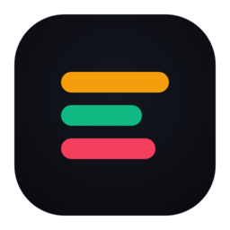

#  My DayCal

**Minimalist tactile daily timeline planner for Android & Web.**

[-14B8A6?logo=android&logoColor=white)](#)
[-3B82F6?logo=jetpackcompose&logoColor=white)](#)

---

## Overview

**My DayCal** is a fast, distraction-free daily timeline planner for Android built with Kotlin and Jetpack Compose. It focuses your attention on **one single day at a time** through a tactile time-blocking interface, a smooth sequential 7-day week ribbon, proportional 24-hour duration cards, and native local notification reminders.

### Storage Modes

You can use **My DayCal** in two ways right from the start screen:
1. **Continue on Local Storage (No Account Required)** — 100% offline, private on-device SQLite storage powered by Android Jetpack Room (`my_daycal_local.db`).
2. **Sign in with Google (Free Cloud Sync)** — Real-time multi-device synchronization powered by Google Sign-In (`CredentialManager`) and Firebase Cloud Firestore with zero-trust security rules.

---

## Key Features

### 1. Smooth Sequential Week Ribbon & Animated `CW` Badge
- **All-Day Sequential Strip (`SUN` – `SAT`)**: Glide smoothly across a continuous chronological ribbon of days (`±180` days) with snap-fling physics (`rememberSnapFlingBehavior`).
- **Sunday Start-of-Week & Dynamic `CW`**: Calendar Week (`CW`) numbers treat **Sunday** as the start of each new week. The `CW` badge dynamically reflects the first visible date while sliding or the selected date when visible, animating with vertical slide + fade transitions. Selecting a Sunday smoothly aligns it as the start of the visible week.
- **Quick Calendar Jump**: Tap either the `CW` badge or the currently selected day chip to open the full Material 3 Date Picker (`±10` years).

### 2. Dual Timeline Views (`Timeline` & `24h`)
- **Focused Timeline View**:
  - Daily summary progress bar (`tasks • scheduled duration • % DONE`).
  - Chronological task stream with a live `NOW` time indicator and unallocated time gap prompts (`+ Schedule`).
  - Expandable inline quick-adjust pills (`◀ -30m`, `+30m ▶`, `-15m len`, `+15m len`) that automatically reschedule active reminders.
- **24-Hour Continuous Grid (`24h`)**:
  - Full `00:00` – `23:00` hourly axis where scheduled task cards share the same rich design as Timeline mode and **proportionally span across covered hours** according to their duration.
  - Includes a `Hide empty hours` toggle to collapse unbooked slots on busy days.

### 3. Tactile New / Edit Entry Sheet
- **Vertical Looping Time Dials**: Tap the **Hour** card to reveal an interactive **12-hour vertical looping dial** (`01`–`12`), or tap the **Minute** card for a **5-minute increment looping dial** (`00`–`55`), paired with an `AM` / `PM` toggle.
- **Duration & Category Chips**: Horizontal duration chips (`15m`, `30m`, `45m`, `1h`, `1h 30m`, `2h`, `3h`, `4h`) and semantic category pills (`Focus`, `Work`, `Personal`, `Health`, `Break`) with high-contrast color accents.
- **Prominent Task & Details Editor**: Enlarged input container for task titles and multi-line notes, plus a header date pill to reassign tasks to any date.

### 4. Smart Scheduling Safeguards & Reminders
- **Overlap Conflict Detection (`OVERLAP`)**: Automatically detects colliding time blocks on the same day and highlights affected cards with an `OVERLAP` warning badge.
- **Undoable Task Deletion**: Deleting a time block triggers a Snackbar with an **Undo** action that restores both the task and its scheduled notification alarm.
- **Native Notification Reminders**: `AlarmManager` scheduling (`At start`, `5m`, `10m`, `15m`, `30m`, or `1h before`) delivered via the `daycal_task_reminders` notification channel.

### 5. Dual Theme System ("Obsidian Kinetic" Dark & "Warm Ivory" Light)
- Switch instantly between **Obsidian Kinetic Dark** (engineered for OLED contrast and low-light focus) and **Warm Ivory Light** (designed for outdoor and daytime readability) via the top-bar Sun/Moon toggle.

### 6. Resizable Week Agenda Home Screen Widget
- **Scrollable Week Task Sequence**: Shows a continuous chronological sequence of scheduled time blocks across the 7-day week with highlighted 'TODAY' and day badges, time ranges, and category color strips.
- **Universal Sizes & Resizability**: Full launcher resizability (`horizontal|vertical`) supporting common home screen widget sizes (2x2, 3x2, 4x2, 4x3, 4x4).
- **Direct Interactive Navigation**: Tapping any task item opens the app directly to that date; tapping the header `+` action button opens the new task creator.
- **Auto-Sync & Offline Ready**: Seamlessly reads both offline Room SQLite tasks and Google Cloud Firestore tasks, auto-refreshing in real time whenever tasks are created, edited, or deleted.

### 7. Companion Web App with Real-Time Android Sync (`docs/index.html`)
- **Cross-Platform Web & Android Access**: Open the Companion Web App on any desktop or mobile browser and sign in with the **same Google account** used on your Android phone to view, create, edit, and complete tasks in real time.
- **Shared Cloud Firestore Backend**: Connects directly to the same Firebase project (`gen-lang-client-0504309294`) and named Firestore database (`ai-studio-android-daytile-bb9d7cd1-7486-4dce-987f-d18abf26cbde`) under `/users/{uid}/tasks/{taskId}`.
- **Full Feature Parity on Web**:
  - **Timeline & 24-Hour Grid Views** with live `NOW` indicator, `OVERLAP` conflict badges, and inline `±30m` / `±15m` quick adjustments.
  - **New & Edit Entry Modal** with 12-hour & 5-minute increment selectors, `AM`/`PM` toggle, duration presets, categories (`Focus`, `Work`, `Personal`, `Health`, `Break`), and Android reminder settings.
  - **Obsidian Kinetic Dark & Warm Ivory Light Theme Toggle** plus an offline Browser Local Storage fallback mode.

---

## Accessing My DayCal on the Web & Syncing with Android

1. **Automated GitHub Pages Deployment**:
   - The workflow at [`.github/workflows/deploy-web.yml`](.github/workflows/deploy-web.yml) automatically publishes [`docs/index.html`](docs/index.html) to **GitHub Pages** whenever changes are pushed to `main` or `master`.
   - In your GitHub repository, go to **Settings → Pages → Build and deployment** and set **Source** to **GitHub Actions** (or **Deploy from a branch → `main` / `/docs`**).
2. **One-Time Firebase Authorized Domain Setup (for Google Sign-In on Web)**:
   - To allow Google Sign-In popups on your GitHub Pages URL (`<your-username>.github.io`), open the [Firebase Console → Authentication → Settings → Authorized domains](https://console.firebase.google.com/project/gen-lang-client-0504309294/authentication/settings) and add `<your-username>.github.io` (or `localhost` when testing locally).
3. **Real-Time Sync**:
   - Sign in with the same Google account on both the **My DayCal Android app** and the **Companion Web App**. Any task added, shifted, or completed on the web appears immediately on your Android phone timeline and Home Screen Week Agenda Widget.

---

## Credits, Inspiration & Borrowed Concepts

This project's core timeline interaction model and minimalist philosophy are inspired by **[Adiseny/daytile](https://github.com/Adiseny/daytile)**:

- **Original Reference Project**: [`https://github.com/Adiseny/daytile`](https://github.com/Adiseny/daytile) by [@Adiseny](https://github.com/Adiseny)
- **What Was Borrowed / Adapted from `Adiseny/daytile`**:
  - **24-Hour Time-Block Tile Concept**: Representing daily tasks as visual, color-coded time tiles along a 24-hour axis (`00:00` – `23:59`) with start-minute and duration semantics.
  - **Tactile In-Place Tile Adjustments**: Quick duration resizing (`-15m` / `+15m`) and time-slot shifting (`-30m` / `+30m`) directly on the timeline without complex multi-screen forms.
  - **Privacy & Offline-First Ethos**: Providing a zero-account **Local Storage Mode** where all user data stays strictly on the device, honoring Daytile's commitment to local privacy.
- **How `My DayCal` Extends the Concept**:
  - **Sequential 7-Day Week Ribbon & Animated `CW` Badge**: Continuous Sunday-start week slider with snap physics and calendar date picker integration.
  - **Vertical Looping Time Dials & Proportional 24h Spanning**: Interactive 12-hour and 5-minute increment wheel pickers and duration-proportional cards in `24h` view.
  - **Conflict Detection, Undoable Deletion & Reminders**: Real-time `OVERLAP` badges, Snackbar undo restoration, and `AlarmManager` notifications.
  - **Dual Themes, Resizable Home Screen Widget & Web Companion**: Obsidian Dark + Warm Ivory Light themes, scrollable Android Home Screen Week Agenda widget, and a Companion Web App with real-time Google Cloud Firestore sync.

---

## Downloading the APK

Pre-built Android APKs (`My-DayCal-v1.4-release.apk` and `My-DayCal-v1.4-debug.apk`) are automatically built and published on the [**GitHub Releases**](../../releases) page by the repository's GitHub Actions workflow.

1. Go to the [**Releases**](../../releases) section of this repository.
2. Download `My-DayCal-<version>-release.apk` (or `-debug.apk`) from the latest release.
3. Open the downloaded `.apk` file on your Android device (Android 7.0 / API 24 or newer) to install.
4. **Google Sign-In Ready**: Both the `-release.apk` and `-debug.apk` artifacts are pre-configured with the provisioned Firebase OAuth client and signed with the registered OAuth certificate fingerprint (`SHA-1: 11:B0:35:38:20:19:2F:9F:AF:CC:0F:3F:0D:A9:54:B5:E7:0F:BC:43`), so **Sign in with Google** works out of the box.

---

## Automated APK Release Workflow

This repository includes an automated GitHub Actions pipeline at [`.github/workflows/release-apk.yml`](.github/workflows/release-apk.yml):

- **Triggers**:
  - Pushing commits to `main` or `master`.
  - Pushing a version tag (`v*.*`, e.g., `git tag v1.4 && git push origin v1.4`).
  - Manual trigger via **Actions → Build & Release Android APK → Run workflow**.
- **What It Does**:
  - Provisions JDK 21, Gradle, Android SDK 36.1, and restores `app/google-services.json` (which AI Studio omits on GitHub export).
  - Imports the registered OAuth signing certificate from `debug.keystore.base64` into both debug and release keystores so Google Sign-In (`CredentialManager`) succeeds on all GitHub-built APKs.
  - Compiles both Debug and Release APKs (`:app:assembleDebug` and `:app:assembleRelease`) and publishes them to **GitHub Releases**.

---

## Project Structure & Documentation

See [`docs/ARCHITECTURE.md`](docs/ARCHITECTURE.md) for detailed architecture documentation, data models, theme system, security rules, and testing instructions.

---

## Disclaimer — AI-Assisted Development

> **Notice on AI Usage**:  
> This application—including its Kotlin/Jetpack Compose source code, UI/UX layouts, Room & Firebase data layers, Firestore security rules, unit/Robolectric test suites, GitHub Actions CI/CD workflows, and technical documentation—was developed, refactored, and maintained with the assistance of generative AI software engineering tools.
>
> - **Code Review & Verification**: While the codebase is verified using automated Gradle builds, Robolectric JVM tests, and Firestore Emulator security rule tests, AI-generated code may still contain edge-case bugs, UI quirks, or configuration assumptions.
> - **No Warranty**: This software is provided **"AS IS"**, without warranty of any kind, express or implied. Users and contributors are encouraged to inspect the source code, permissions, and Firebase security rules before deploying to production environments or storing sensitive personal information.
